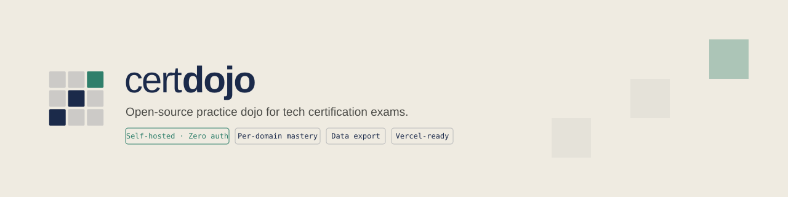

<div align="center">

<picture>
  <source media="(prefers-color-scheme: dark)" srcset="img/certdojo-banner-dark.svg">
  
</picture>

**Your open-source dojo for tech certification exams.**

Practice realistic MCQs, get instant explanations, and watch your mastery grow
domain by domain — on your machine, with your data.

[](https://github.com/antonyftp/CertDojo/actions/workflows/ci.yml)
[](LICENSE)
[](https://nextjs.org)
[](https://react.dev)
[](CONTRIBUTING.md)

[Quick start](#-quick-start) · [Deploy to Vercel](#%EF%B8%8F-deploy-to-vercel) · [Question banks](#-question-banks) · [Contributing](#-contributing)

</div>

---

## 🥋 What is CertDojo?

CertDojo is a **self-hosted practice space** for tech certification exams
(AWS, CNCF, HashiCorp, …). Pick the certifications you're preparing, answer
exam-style single- and multiple-choice questions, and track your real
readiness against the official exam blueprint.

- 🔒 **Your data stays yours.** Single-user by design: no accounts, no
  authentication, no telemetry. Everything lives in a SQLite file on your
  machine (or your own Postgres if you deploy to Vercel).
- 📊 **Honest progress, zero gamification.** No XP, levels, or streaks.
  Mastery is simply the share of questions whose latest attempt is correct —
  overall and per exam domain, weighted like the real blueprint.
- 💬 **Every answer teaches.** Instant feedback with an explanation of why
  the right answer is right.
- 🧩 **Community question banks.** Certifications are plain JSON files in
  this repo, validated in CI — add one with a pull request, no code needed.
- ✈️ **Offline-friendly.** Local mode makes zero network requests once
  installed.

## 🚀 Quick start

### Option A — Docker (no Node.js required)

Requires [Docker](https://docs.docker.com/get-docker/) with the Compose
plugin (included in Docker Desktop).

```bash
git clone https://github.com/antonyftp/CertDojo.git
cd CertDojo
docker compose up -d --build
```

Open <http://localhost:3000> — migrations run automatically on first start,
no extra setup. Your progress lives in the `certdojo-data` volume and
survives restarts, rebuilds, and `docker compose down`.

<details>
<summary><b>Day-to-day Docker commands</b></summary>

```bash
docker compose stop      # stop, keep everything
docker compose start     # start again
docker compose down      # remove the container — your data is kept
docker compose up -d     # recreate; progress is still there

git pull && docker compose up -d --build   # update to a new version
                                           # (new migrations apply on startup)

docker compose down -v   # ⚠️ reset: permanently deletes profile and progress
```

To serve on another port, edit `ports` in `docker-compose.yml`
(e.g. `"8080:3000"` for <http://localhost:8080>).

</details>

### Option B — Node.js

Requires Node.js 20+ (24 recommended).

```bash
git clone https://github.com/antonyftp/CertDojo.git
cd CertDojo
corepack enable pnpm
pnpm install
pnpm dev
```

Open <http://localhost:3000>. The database is a SQLite file at
`data/certdojo.db`, created and migrated automatically on first run
(override the path with `SQLITE_PATH`). For a production build:
`pnpm build && pnpm start`.

## ☁️ Deploy to Vercel

CertDojo runs on Vercel with zero config — it just switches from SQLite to
Postgres automatically.

1. **Import the repo** on [vercel.com/new](https://vercel.com/new) (push it
   to GitHub/GitLab/Bitbucket first). The first deployment builds, but the
   app can't store data yet.
2. **Attach Postgres**: project → **Storage** → **Create Database** → pick a
   Postgres provider (e.g. **Neon**). This injects `DATABASE_URL` (and the
   legacy `POSTGRES_URL` alias) into the project.
3. **Redeploy** so the new environment variables are picked up.
4. **Apply the migrations** once, from your machine:

   ```bash
   pnpm dlx vercel link            # select the Vercel project
   pnpm dlx vercel env pull .env.local
   pnpm db:migrate                 # applies src/db/migrations/postgres
   pnpm db:smoke-test              # optional: write/read/delete one row per table
   ```

   Repeat `pnpm db:migrate` whenever a new version ships schema changes.

> [!NOTE]
> If the app runs on Vercel without a Postgres database attached, requests
> fail with an explicit error instead of silently trying to write SQLite to
> the read-only filesystem. Question banks are bundled read-only into the
> serverless functions — nothing is ever written to disk in Vercel mode.

## 🗄️ How your data is stored

The database mode is detected automatically — there is no toggle:

| Mode       | When                                          | Storage                                       |
| ---------- | --------------------------------------------- | --------------------------------------------- |
| **Local**  | default                                       | SQLite file at `data/certdojo.db` (`SQLITE_PATH` to override) |
| **Vercel** | `POSTGRES_URL` / `DATABASE_URL` set           | your Postgres database (e.g. Neon)            |

Detection lives only in `src/db/client.ts`. To test the Postgres path
locally, point `POSTGRES_URL` at a dev database and run
`pnpm db:migrate && pnpm db:smoke-test`.

**Never locked in**: *Settings → Export my data* downloads a JSON backup
(profile, tracked certifications, attempts) that you can re-import on any
other CertDojo instance, in either mode.

## 📚 Question banks

Currently shipped certifications:

| Provider | Certification                        | Exam code | Questions |
| -------- | ------------------------------------ | --------- | --------- |
| AWS      | AWS Certified Cloud Practitioner     | CLF-C02   | 20        |
| CNCF     | Kubernetes and Cloud Native Associate| KCNA      | 14        |

Content is plain JSON, versioned in Git, never stored in the database:

```
content/
  <provider>/            e.g. aws, cncf
    <slug>/              e.g. clf-c02, kcna
      meta.json          name, exam code, official URL, domain blueprint
      questions.json     the question bank
```

Everything is validated by strict Zod schemas — locally with
`pnpm validate-content`, and in CI on every pull request.

**Want your certification in this table?** Adding one is a pure-JSON pull
request — the field-by-field guide is in [CONTRIBUTING.md](CONTRIBUTING.md).
Original questions only: no exam dumps.

## 🧑‍💻 Development

```bash
pnpm dev                # dev server on :3000
pnpm lint               # eslint
pnpm format:check       # prettier (pnpm format to write)
pnpm typecheck          # next typegen + tsc --noEmit
pnpm test               # Vitest unit/integration tests
pnpm test:e2e           # Playwright e2e (once: pnpm exec playwright install --with-deps chromium)
pnpm validate-content   # validate /content against the Zod schemas
pnpm db:generate        # regenerate migrations for both dialects
pnpm db:migrate         # apply migrations for the detected mode
pnpm db:smoke-test      # write/read one row per table in the detected mode
```

The Playwright suite covers the critical flow (onboarding → quiz →
dashboard) against a throwaway SQLite database on a dedicated port — it
never touches your real data. CI runs lint, format check, typecheck, content
validation, unit tests, and the e2e suite on every pull request.

**Stack**: Next.js 16 (App Router) · React 19 · TypeScript · Tailwind CSS 4 ·
shadcn/ui (Radix) · Drizzle ORM · Zod · Vitest · Playwright

## 🤝 Contributing

All contributions are welcome — new question banks most of all, because
they're what makes CertDojo useful.

- 📖 Read [CONTRIBUTING.md](CONTRIBUTING.md) — it's self-contained: directory
  layout, JSON formats with examples, validation, PR process.
- 🐛 Found a bug or wrong answer? [Open an issue](https://github.com/antonyftp/CertDojo/issues).
- ⭐ If CertDojo helps you pass an exam, a star helps others find it.

## 📄 License

[MIT](LICENSE) — use it, fork it, ship it.
